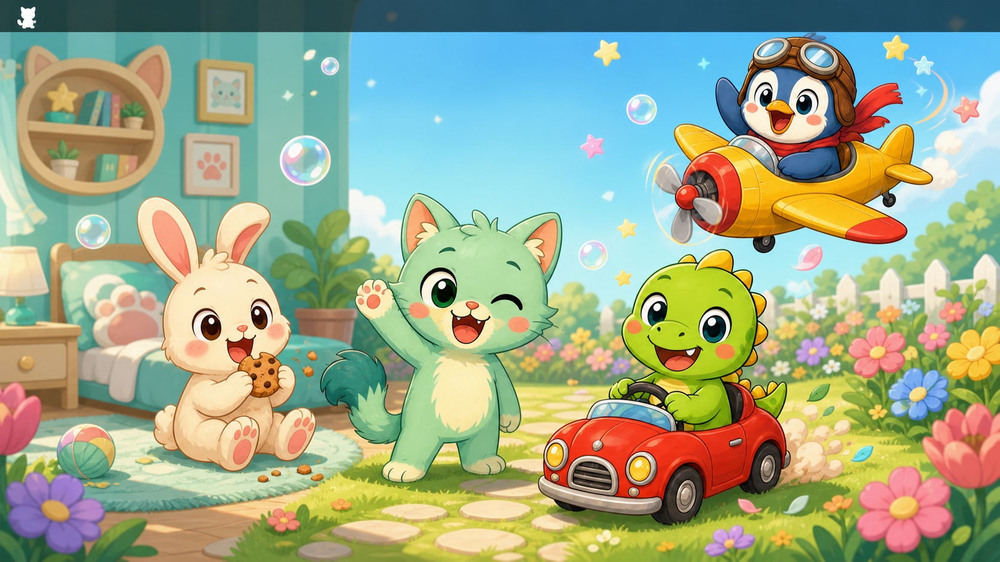

# Mimo

A small cartoon pet that lives in the macOS menu bar. This MVP uses Tauri 2, vanilla TypeScript, and a tiny Rust tray layer.

**[Download Mimo for Apple Silicon](https://github.com/iamapinan/mino/releases/latest)**

After dragging Mimo to Applications, right-click `Mimo.app` and choose **Open** the first time. If macOS still shows an old “damaged” quarantine warning, run:

```bash
xattr -dr com.apple.quarantine /Applications/Mimo.app
open /Applications/Mimo.app
```

Mimo can also chat in Thai or English using a small local context engine. Replies consider keywords, time of day, and the pet's current needs. No account, network request, or AI API is required.

Choose between four cartoon companions: Mimo the forest cat, Rexo the tiny dinosaur, Mallow the soft rabbit, and Pingo the little penguin. Each companion can be given a custom name, which is used by the chat UI and menu bar tooltip. The selected character is also reflected in the macOS menu bar icon.

Menu bar icons use simple monochrome template silhouettes. macOS renders them white on a dark menu bar and dark on a light menu bar for reliable contrast.

The room characters use hand-designed high-resolution raster cartoon sheets rather than assembled vector shapes. Each companion has 12 dedicated poses, including clean, cheerful, dirty, hungry, yawning, exhausted, playing, car-driving, airplane-flying, curled-up sleeping, feeding/chewing, and washing. Every pose has a validated four-frame animation cycle. Feeding visibly moves the mouth and cheeks through bite, chew, swallow, and smile frames; washing moves through bubbles, scrubbing, shaking off water, and sparkling clean. Dust, tummy-rumble marks, sweat, crumbs, soap bubbles, sparkles, road dust, wind streaks, and sleep Zs animate independently on a separate effects layer.

Four hand-painted 2D cartoon scenes are included: Cozy Room, Sunny Garden, Starry Night, and Seaside. The macOS app icon is also a dedicated 2D cartoon graphic. Clicking the macOS menu bar pet opens a native command menu for feeding, playing, cleaning, sleeping or waking, driving, flying, cycling scenes, opening the full window, and quitting. Right-click context menus are disabled in the main webview and any accessible embedded iframe.

## Run

Requirements: Node.js, Rust, and the macOS Command Line Tools.

```bash
npm install
npm run tauri dev
```

Click Mimo in the menu bar to open or hide the pet window. Right-click the icon to quit.

## Build a local prototype app

```bash
npm run tauri build -- --debug
```

The result is written to `src-tauri/target/debug/bundle/macos/Mimo.app`.
For public distribution, create a release build and add Apple code signing and notarization.

## GitHub DMG release

The `Release macOS DMG` GitHub Actions workflow builds a release DMG and uploads it to a GitHub Release. Run it manually with a version tag such as `v0.1.0`, or push a `v*` tag:

```bash
git tag v0.1.0
git push origin v0.1.0
```

The save is stored locally in the webview's `localStorage`. Needs progress from elapsed time, so the app does not require a background game loop or server.
